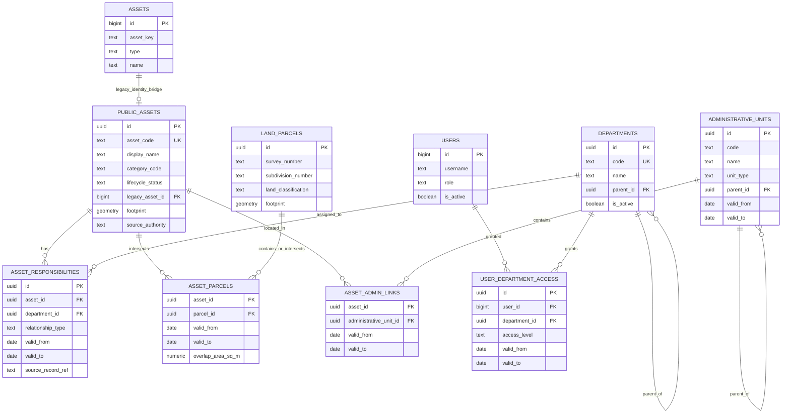
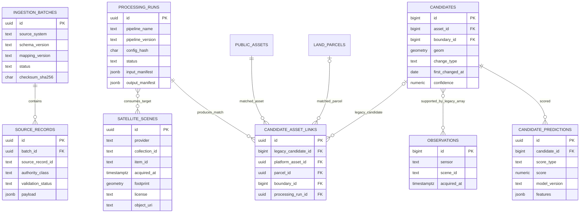
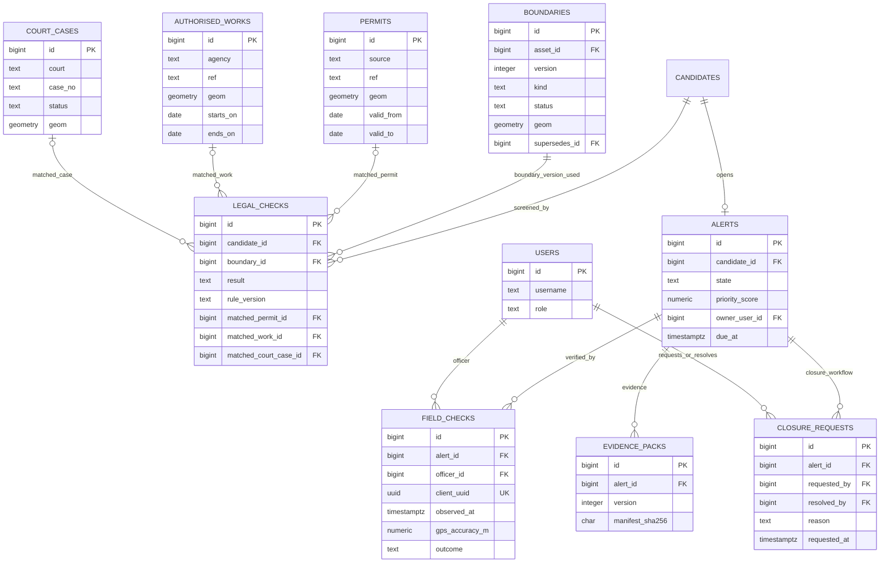
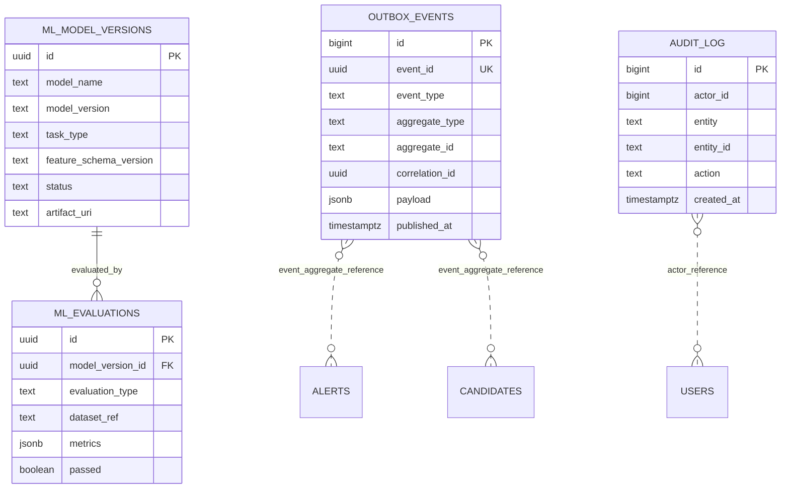

# Unified Logical Entity Relationship Diagram

This diagram is a domain-level view. It intentionally groups the current legacy lake workflow and the statewide canonical model. Solid relationships represent current physical foreign-key relationships where present; target entities are marked **(target)** and are not claims about current database tables.

## 1. Asset identity, administration and responsibility

## 2. Source ingestion, earth observation and candidate lineage

The current legacy `candidates.observation_ids` is an array, not a normalized FK relationship. A normalized candidate-observation bridge is a target migration once dual-read/backfill/compatibility is planned.

## 3. Legal screening, alerts, field response and evidence

## 4. ML governance, audit and events

## Relationship rules that are not obvious from the ERD

- `public_assets` is the canonical identity; `assets` is the legacy lake identity during migration.
- `asset_responsibilities` is many-to-many and effective-dated. Do not collapse the relationship types into one owner field.
- `asset_parcels` is many-to-many and effective-dated.
- Boundaries are versioned. Historical candidates and legal checks must retain the exact boundary version they used.
- A candidate can have more than one canonical asset/parcel match. The current `alerts.candidate_id` unique constraint means the current lake workflow permits one alert per candidate; statewide case aggregation across candidates is a target design.
- A prediction is not a human decision. Human review and formal legal outcomes require separate records.
- `outbox_events` are delivered at least once; downstream handlers must deduplicate by `event_id`.
