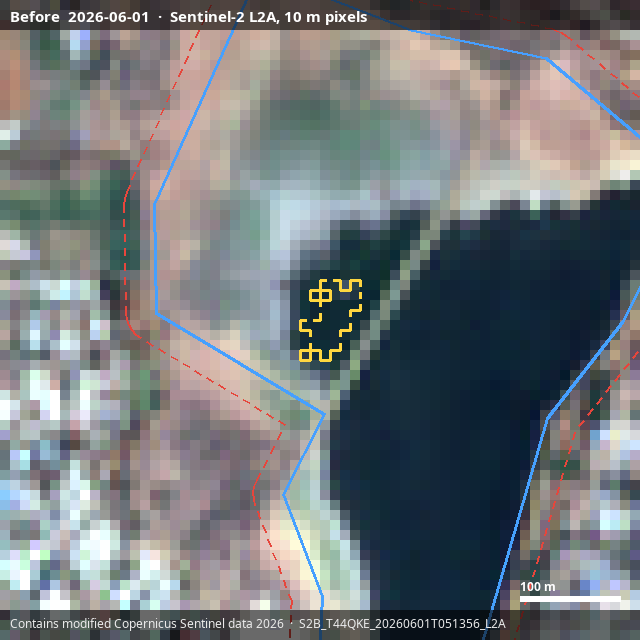
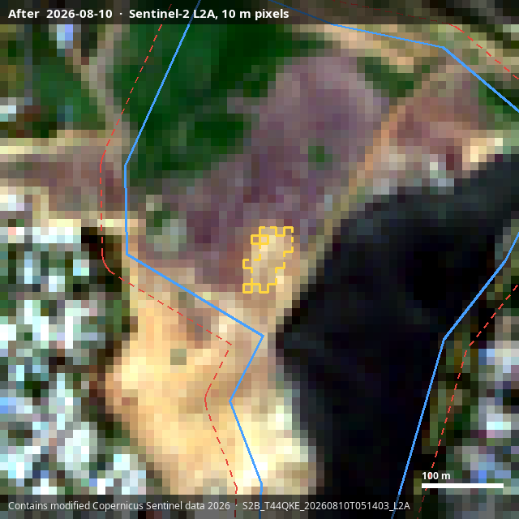

<!-- _class: lead -->

# Lake Protect

## A weekly satellite watch that reaches the field, and cases that hold up

TISC 2026 · Protecting Lakes and Government Land · Aanvi Infotech

<!--
Open with the promise, not the technology. We are not selling more alerts; we are selling cases that hold up.
Fifteen seconds. Move on.
-->

---

<!-- _class: big-number -->

# 61%

## of Hyderabad's lake area lost between 1979 and 2024 (NRSC)

HYDRAA warns the remaining lakes could vanish within 15 years

<!--
Source: NRSC figures as reported by Deccan Chronicle and NewsMeter (CONTEXT.md section 16).
Then the problem in one line: Telangana can already see its lakes. What it lacks is a recurring loop
that turns each new change into a dated, court-ready case, owned by a named officer with a deadline.
The High Court has stayed actions where boundaries "were not clear" (Khajaguda) and where notice was
missing (Kokapet, May 2026). Weak evidence, not weak detection, is what loses land back.
-->

---

### 1 · Encroachment and how we detect it

## Encroachment takes six forms, and each leaves a different trace

| Form | What changes | How we catch it |
|---|---|---|
| Soil or debris dumped | Water turns to bare soil at the edge | Weekly optical screen |
| Land cleared and levelled | Vegetation turns to bare soil | Optical screen; sub-metre for plot lines |
| Sheds, fences, walls | Smaller than one 10 m pixel | Sub-metre images or a field visit |
| Buildings in FTL or buffer | Built-up index and radar return rise | Optical plus radar; sub-metre footprint |
| Nalas and feeders blocked | Channel narrows or disappears | Sub-metre images |
| Government land occupied | New structures or fencing on a parcel | Same signals, once the parcel boundary is official |

<!--
Walk the stages in order: soil dumped, land levelled, sheds and fences, building rises, family moves in.
We alert at the first three, while the change is still reversible. HYDRAA has said occupied homes will
not be demolished, so time matters. Proposed target: 60% of confirmed cases caught before a permanent
structure (a target, not a result).
Be candid: sheds and walls under 10 m are never claimed from Sentinel. Water loss alone never alerts,
because season and drought shrink lakes too.
Nala blocking and parcel occupation are on the roadmap: they need sub-metre images and official parcel
boundaries respectively.
-->

---

### 1 · Encroachment and how we detect it

## Screen every lake weekly, sharpen only where it matters

<strong>1 · Screen</strong>Every lake, at least weekly<small>Sentinel-2 optical at 10 m, every 5 days; Sentinel-1 radar sees through monsoon cloud</small>

<strong>2 · Confirm</strong>Priority cases only<small>Sub-metre images: Cartosat-3 through NRSC, or commercial at 0.3 to 0.5 m</small>

<strong>3 · Verify</strong>On the ground<small>A field officer with geotagged, hashed photos; CCTV and drones where they exist</small>

Indices: water (MNDWI), vegetation (NDVI), bare soil (BSI), built-up (NDBI), radar return (VV/VH) · each tier may use free, ISRO or commercial imagery, chosen per phase

<!--
This is the cost logic. Sub-metre imagery for 900 lakes every week is unaffordable and unnecessary.
Medium-resolution optical and radar screen everything; sharp images are bought only for the few cases
that reach priority; a person confirms on the ground.
Radar matters most from June to September, when cloud cover over Hyderabad averages 79 to 89%.
Radar-only alerts are marked "optical confirmation pending".
-->

---

### 1 · Encroachment and how we detect it

## Every alert dates the change: last clear image, first changed image

<b>Real Sentinel-2 pair, Hyderabad, 1 Jun → 10 Aug 2026:</b> water to bare soil inside the lake outline, 2,700 sq m. A candidate change; its cause is not verified.

<!--
Real images from the prototype's own screen, not a mock-up. Blue is the lake outline, red the buffer,
yellow the changed pixels.
This is Kapra lake, one of our five tuning lakes, where HYDRAA reported restoration works in 2026.
That is the point: restoration looks like encroachment from space. The automatic legal check looks for
authorised works before anyone is sent out.
The dated bracket (last clear look, first changed look) is the most useful single field in a case file:
it answers "when did this start?" before anyone asks.
-->

---

### 2 · Solution architecture

## One core decides what deserves an officer's time

<h4>Channels in</h4>

<b>Satellite images</b>Optical and radar weekly; sub-metre on cue

<b>Mobile field app</b>Officers: offline, Telugu, geotagged photos

<b>WhatsApp</b>Citizen reports: photo, pin, note

<b>Web app</b>Citizen reports; 1070 and Praja Vani entered here

<b>Government records</b>FTL notices, permits, works, court cases, survey nos.

<b>Ground signals</b>900 CCTV cameras, lake guards

→

<h4 style="color:var(--color-accent)">Lake Protect core</h4>

Process imagery

Catalogue each scene

Process it once

Match every asset

Analyse

Detect change

Legal check

Set priority

Analyst review

Act

Route, with a deadline

Field check

Seal evidence

<b>Asset registry</b> with versioned boundaries and their status · imagery record · case history

<b>Every layer:</b> access by role and area · every action logged in a hash chain · missed deadlines escalate

↺ Field outcomes feed back to tune detection

→

<h4>Portals out</h4>

<b>Citizen portal</b>Track a report by reference number: received, checked, closed with a reason

<b>Officer portal</b>Analyst desk, field tasks, case file, deadlines

<b>Evidence pack</b>Sealed by SHA-256, with a Section 63(4) certificate

<b>Leadership page</b>Monthly view, State to survey number

<b>Notifications</b>Inbox, SMS, WhatsApp, daily email

<!--
Left to right: anything that can signal a change comes in on the left; one core decides what deserves
an officer's time; two portals and three outputs carry the result.
Four things the core guarantees:
1. The legal check runs before routing: out-of-scope, legacy, authorised and court-held changes never
   reach a field team.
2. Boundary status gates action: only final or physically marked boundaries get the full officer path.
3. The citizen portal shows status only: never the accused, never owner names.
4. The field app is both a channel (photos in) and a portal (tasks out).
The heavy pieces (message brokers, Kubernetes, deep learning) are added only when measured load needs
them. Cases and alerts keep working when satellite processing is down.
-->

---

### 3 · Rules enforced

## A legal check runs before anyone moves

| Check, in order | Result |
|---|---|
| Outside the FTL, buffer and watch ring? | Closed: out of scope |
| First changed before the baseline date? | Closed: legacy, logged |
| Matches an authorised work or a valid permit? | Closed: authorised (inside the FTL: flagged) |
| Live court matter? | Hold for the legal officer |
| Lake not yet notified? | Watch list |
| Otherwise | Triage for analyst review |

Each result stores the rule version, the boundary version and the records it matched · only confirmed boundaries (final notice or physically marked) lead to action

<!--
This is what turns a detection into a case that survives the High Court.
Boundary status by cohort: recovered land and lakes with a final notice get the full action path;
preliminary notice is action too; derived outlines go to field verification without an officer path;
survey-number-only land stays watch-only until a parcel boundary exists. Only 765 of 3,342 HMDA lakes
(23%) have a final FTL notice, so starting where boundaries are certain is a choice, not a limitation.
A live court matter moves any alert to a legal hold, whatever the cohort.
-->

---

### 3 · Rules enforced

## Six rules no one can switch off

<b>1 · Officers decide</b>No legal labels, no demolition advice; a test checks every English and Telugu string

<b>2 · Boundary status shown</b>Every alert shows how certain its boundary is; only confirmed ones lead to action

<b>3 · New change only</b>Change first seen before the baseline date is closed as legacy

<b>4 · Owner-blind</b>Names appear only after field confirmation, to authorised roles; every view logged

<b>5 · Nothing closes silently</b>24 transition rules in the database; two people to close; missed deadlines escalate

<b>6 · No invented results</b>Demo data is labelled fictional; no accuracy claimed before the blind backtest

<!--
These are enforced in code, not policy text:
- Rule 1: an automated wording test fails the build if words such as "illegal" or "encroacher" appear.
- Rule 5: the alert state machine is a database trigger with 24 transition rules; closures as "not real",
  "false alarm" or "no action" need two different people and a reason code. Deadlines: e.g. assign a
  field officer in 1 working day, site check in 7 days (48 h if urgent). Unacknowledged in 24 hours:
  repeated and escalated. Deadlines are proposals to agree with HYDRAA and the Revenue Department.
- Rule 4 exists so an alert can never be used to target or extort the people named.
- The baseline date for the 99 real lakes is 19 July 2024.
-->

---

### 3 · Rules enforced

## Controls cut 124,203 changed pixels to 58 candidates

124,203changed pixels around 99 lakes

58candidate changes kept

25building candidates refused by radar

- **Persistence:** two looks at least 5 days apart, no reversal
- **Minimum area:** 1,000 sq m, about a quarter acre
- **Season and drought:** same months in earlier years; worse than the 5 nearest lakes
- **Buildings:** radar return must rise at least 3 dB
- **Baseline:** nothing first changed before the baseline date

Real screen of 22 Nov 2026 · each pixel is 10 m × 10 m · candidates are not findings: accuracy is measured only by the blind backtest

<!--
Real numbers from the prototype's screen of 99 Hyderabad lakes with images up to 22 November 2026.
The controls held back the seasonal and one-off changes; 58 candidate changes remained on 15 lakes
(46 clearing, 11 soil fill, 1 building confirmed by radar at +5.3 dB). Radar refused 25 Sentinel-2
building candidates whose return did not rise.
All 58 sit on the watch list because these lake outlines are derived from OpenStreetMap, not notified.
Thresholds are starting values, tuned only on five separate tuning lakes and frozen before the backtest.
Designed for the monsoon: radar-only alerts, marked "optical confirmation pending" (not yet built).
Do not present 58 as encroachments: they are candidates awaiting review.
-->

---

### 4 · Technology and data

## Optical, radar and sub-metre imagery, each with one job

| Source | Detail | Job |
|---|---|---|
| Sentinel-2 L2A | Optical, 10 m, every 5 days | Weekly screen: water, vegetation, soil, built-up |
| Sentinel-1 | Radar, 10 m, sees through cloud | Confirms buildings; watch through the monsoon |
| Cartosat-3 or commercial | Sub-metre, 0.3 to 0.5 m | Confirms priority cases: footprints, sheds, plots |
| Field, CCTV, drones | Geotagged, hashed photos | Verifies on the ground |
| Boundaries | HMDA and HYDRAA FTL files | Replace the derived outlines used today |

Prototype reads Sentinel-2 from Earth Search and Sentinel-1 from Planetary Computer as cloud-optimised windows, never whole scenes · "Contains modified Copernicus Sentinel data 2026"

<!--
Sentinel data is free and open under the Copernicus licence; every derived image carries the notice.
ISRO high-resolution imagery is free to government bodies under the Indian Space Policy 2023, routed
through NRSC (routing not yet confirmed). Commercial tasking at 30 to 50 cm is the fallback.
Sharing imagery at 30 cm or finer needs IN-SPACe authorisation, so anything shared defaults to 50 cm.
Official FTL files from HMDA or HYDRAA-Raksha replace the OpenStreetMap outlines; until then every
real alert stays on the watch list.
-->

---

### 4 · Technology and data

## An open, portable stack the State can host and own

<b>Detection</b>Python, STAC catalogues, Rasterio, NumPy · rules versioned and hashed on every run

<b>Platform</b>FastAPI modular monolith · PostgreSQL 16 with PostGIS 3.4 · append-only tables, hash-chained audit

<b>Apps</b>React and MapLibre analyst desk · offline field app in English and Telugu · WeasyPrint evidence packs

<b>Hosting</b>Docker on one server · State Data Centre or an Indian cloud · State owns all data · runs offline

Pilot State single sign-on and MFA, row-level security by department and area, S3 storage with object lock, transactional outbox &nbsp; Later Kubernetes or a message broker only on measured need; deep learning trained on officer-verified outcomes

<!--
No licence fees in the core stack, and nothing that locks the State to one vendor or one imagery
provider. The whole demo, including maps, runs without internet.
Deep learning is deliberately later: there is no labelled Hyderabad training data today, and explainable
index rules are easier to defend in court. Officer-verified outcomes become the training set.
The pilot additions are designed, not built; say so if asked.
-->

---

### 4 · Technology and data

## Already screening 99 real Hyderabad lakes

99lakes inside the ORR

7,652clear looks since 2022

14 daysevery lake seen clearly within

28 minfull screen on one laptop

The officer loop (legal check, field app, evidence pack, monthly page) runs end to end, offline, on a labelled fictional demo world · 249 API tests and 15 browser tests pass · no accuracy claimed until the blind backtest on 30 public cases

<!--
Images up to 22 November 2026. Every one of the 99 lakes had a clear look within the last 14 days.
The first screen, from March 2022 to November 2026, took 28 minutes on a laptop CPU; a rerun from
cache takes minutes. No GPU is needed for the pilot.
Coverage is reported honestly: the system never shows "no change" where no valid observation exists.
Offer the live demo here if time allows.
-->

---

### What happens next

## Each phase must earn the next

<strong>Dec 2026</strong>Blind backtest<small>30 public cases on archived images · gate: at least 21 of 30 flagged before public action · no cost</small>

<strong>Jan to Mar 2027</strong>Demonstration<small>About 20 recovered assets with HYDRAA · gate: officer named, boundaries shared · no cost</small>

<strong>Apr to Sep 2027</strong>Paid pilot<small>100 lakes and 10 parcels through one monsoon · ₹40 to 60 lakh</small>

<strong>From Oct 2027</strong>Core urban region<small>900+ lakes and recovered assets · ₹4.5 to 9.5 crore a year</small>

Indicative cost to Government; planning estimates, not quotes · we stop if the backtest flags under 15 of 30, or precision is under 50% at pilot month 4

<!--
The ask: a named officer and official boundary files for the demonstration on recovered assets.
Pilot targets, to agree with HYDRAA, not results: 70% field-confirmed precision by month 6; 14 days
median from first change to field check (30 in monsoon); 60% of confirmed cases caught before a
permanent structure; 100% of alerts with a named owner and closure reason; 90% of evidence packs
accepted by legal without rework.
Scale: one year of watch for the core urban region costs less than one acre of recovered land
(HYDRAA's market estimate for Ailapur: ₹17.4 crore an acre).
-->

---

<!-- _class: lead -->

# Recovered land stays recovered

## and every action stands up in court

Lake Protect · a weekly watch, a legal check, a field visit, a sealed case file

<!--
Reprise the commercial: Telangana can see its lakes. Lake Protect turns each new change into a dated,
checked, field-verified case with a named officer and a deadline, sealed so it holds up in court.
Pause for questions; use the appendix.
-->

---

### Appendix

## Detection rules, and what is live today

| Rule | What it watches | Status |
|---|---|---|
| R01 Water spread | Context only: water loss alone never alerts | Built |
| R02/R03 Building in FTL or buffer | 10 m screen with radar; sub-metre confirm | Built Pilot |
| R04 Soil fill or dumping | Water to bare soil at the lake edge | Built |
| R05 Government parcel occupation | Surveyed agency land, from 2028 | Later |
| R06 Vegetation clearing | Vegetation to bare soil, against last year | Built |
| R07 Levelling or excavation volume | Drone or stereo height models | Later |
| R08/R09 Nala, feeder and road | Sub-metre images for narrow channels | Later |
| R10 Citizen report check | Match to an asset, recheck the latest look | Pilot |

<!--
Rules are a versioned YAML file (detect-v1); its SHA-256 is recorded on every run, so any case can show
exactly which rules produced it.
-->

---

### Appendix

## Boundary status decides what an alert may do

| Cohort | Asset | Boundary | Alert may |
|---|---|---|---|
| A | Recovered land in State hands | Physically marked | Act: full officer path |
| B | Lake with final notification | Final notice | Act |
| C | Lake with preliminary notification | Preliminary | Act |
| D | Lake without notification | Derived | Verify: field check only |
| E | Surveyed agency land | Agency survey | Act, routed to the owning agency (2028) |
| F | Revenue land by survey number only | Survey number | Watch |

A live court matter moves any alert to a legal hold, whatever the cohort · the 99 real lakes today are cohort D

<!--
Source: the shortlisted proposal. Cohorts A to D start in the 2027 pilot; E from 2028; F later.
-->

---

### Appendix

## What exists, what the pilot adds, what comes later

| Area | Built | Pilot | Later |
|---|---|---|---|
| Detection | Sentinel-2 and radar on 99 real lakes | Blind backtest; sub-metre confirm | Deep learning on verified outcomes |
| Workflow | Legal check, state machine, escalation | Agreed deadlines with HYDRAA | Per-category policies |
| Field and evidence | Offline field app; sealed packs; verify tool | Counsel-reviewed certificate | Drone integration |
| Citizens | Signals table | WhatsApp and web intake, in English, Telugu and Urdu | — |
| Security | Role checks, hash-chained audit | State SSO, MFA, row-level security | Key management, high availability |

<!--
Proposal slide 26 lists the statewide registry, department security, S3 storage and the outbox as built;
they are designed, not built. This slide is the accurate version: use it if the jury asks.
-->
