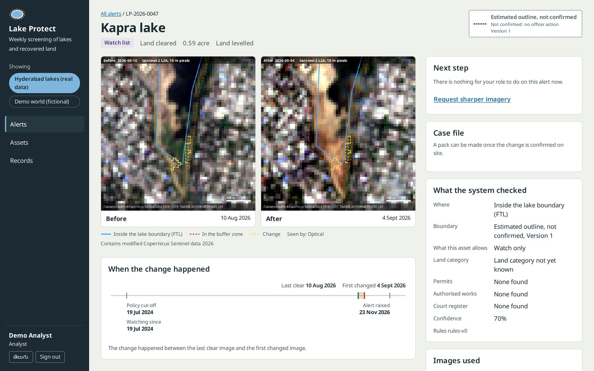
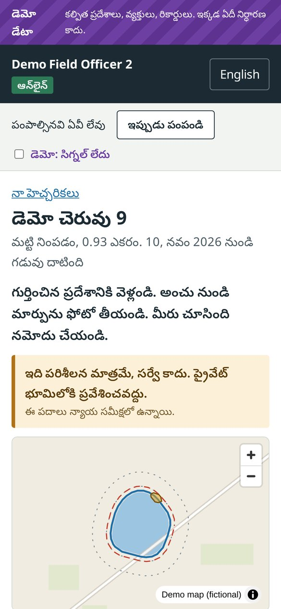
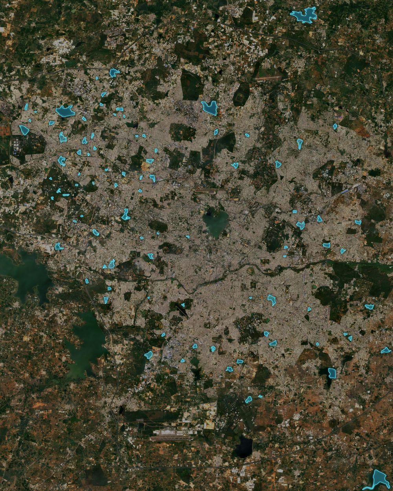
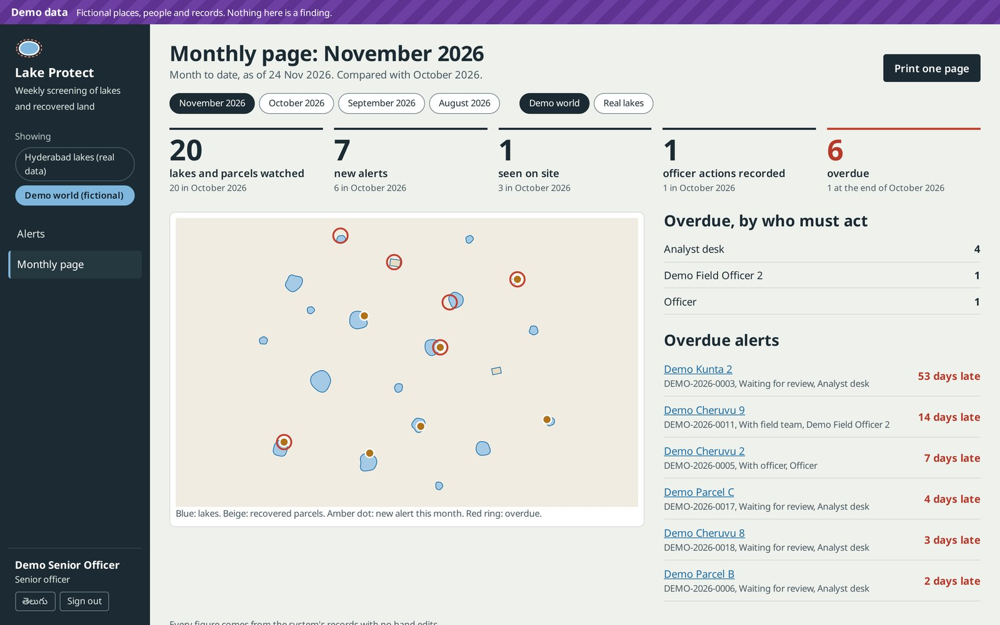

<!-- _class: dark hero -->
<!-- _paginate: false -->
<!-- _backgroundImage: "linear-gradient(90deg, rgba(6,18,32,.96) 0%, rgba(6,18,32,.86) 38%, rgba(6,18,32,.35) 72%, rgba(6,18,32,.15) 100%), url('img/hero-hyderabad.jpg')" -->
<!-- _backgroundSize: cover -->

Lake Protect

<h1 style="margin-top:26px;max-width:780px">A weekly satellite watch that reaches the field, and <em>cases that hold up</em></h1>

Lakes and government land in Telangana: screened from space, checked against the records, verified on the ground

<i class="ic ic-trophy"></i>TISC 2026<i class="ic ic-waves"></i>Protecting Lakes and Government Land<i class="ic ic-building"></i>Aanvi Infotech

Hyderabad up to the ORR · Sentinel-2 mosaic, Sep to Oct 2026 Contains modified Copernicus Sentinel data 2026

<!--
Open with the promise, not the technology. We are not selling more alerts; we are selling cases that
hold up. The background is our own Sentinel-2 mosaic of Hyderabad, the same base map the app uses offline.
-->

---

<b>!</b>The problem

## Hyderabad has lost *61%* of its lake area, and the watch has not kept up

61%

of Hyderabad's lake area lost between 1979 and 2024 (NRSC)

<i class="ic ic-droplet lost"></i><i class="ic ic-droplet lost"></i><i class="ic ic-droplet lost"></i><i class="ic ic-droplet lost"></i><i class="ic ic-droplet lost"></i><i class="ic ic-droplet lost"></i><i class="ic ic-droplets kept"></i><i class="ic ic-droplets kept"></i><i class="ic ic-droplets kept"></i><i class="ic ic-droplets kept"></i>

Each drop is about a tenth of the 1979 lake area

<i class="ic ic-hourglass"></i>HYDRAA warns the remaining lakes could vanish within 15 years

<i class="ic ic-map"></i>

920

water bodies mapped up to the ORR (TGRAC)

<i class="ic ic-cctv"></i>

656

of them with no routine watch; CCTV covers 264 lakes

<i class="ic ic-file-check"></i>

23%

of HMDA lakes have a final FTL notice (765 of 3,342)

<i class="ic ic-gavel"></i>

Cases stall

the High Court found boundaries "not clear" (Khajaguda)

<!--
Sources: NRSC figures via Deccan Chronicle and NewsMeter; TGRAC survey; HMDA (January 2025); HYDRAA
CCTV (May 2026). All in the proposal and CONTEXT.md section 16.
The problem in one line: Telangana can already see its lakes. It lacks a recurring loop that turns each
new change into a dated, court-ready case, owned by a named officer with a deadline.
-->

---

<b>01</b>Encroachment and how we detect it

## Encroachment takes six forms, and *each leaves a different trace*

<i class="ic ic-truck"></i>
<h3>Soil or debris dumped</h3>

<i class="ic ic-eye"></i>Water turns to bare soil at the edge

<i class="ic ic-satellite"></i>Weekly optical screen

<i class="ic ic-shovel"></i>
<h3>Land cleared and levelled</h3>

<i class="ic ic-eye"></i>Vegetation turns to bare soil

<i class="ic ic-satellite"></i>Optical screen<i class="ic ic-zoom-in"></i>Sub-metre for plot lines

<i class="ic ic-fence"></i>
<h3>Sheds, fences, walls</h3>

<i class="ic ic-eye"></i>Smaller than one 10 m pixel

<i class="ic ic-zoom-in"></i>Sub-metre images<i class="ic ic-map-pin"></i>Field visit

<i class="ic ic-building-2"></i>
<h3>Buildings in FTL or buffer</h3>

<i class="ic ic-eye"></i>Built-up index and radar return rise

<i class="ic ic-satellite"></i>Optical<i class="ic ic-radar"></i>Radar<i class="ic ic-zoom-in"></i>Footprint

<i class="ic ic-waves"></i>
<h3>Nalas and feeders blocked</h3>

<i class="ic ic-eye"></i>Channel narrows or disappears

<i class="ic ic-zoom-in"></i>Sub-metre images

<i class="ic ic-landmark"></i>
<h3>Government land occupied</h3>

<i class="ic ic-eye"></i>New structures or fencing on a parcel

<i class="ic ic-satellite"></i>Same signals<i class="ic ic-map"></i>Once the parcel boundary is official

<!--
Be candid: sheds and walls under 10 m are never claimed from Sentinel. Water loss alone never alerts,
because season and drought shrink lakes too. Nala blocking and parcel occupation are on the roadmap:
they need sub-metre images and official parcel boundaries respectively.
-->

---

<b>01</b>Encroachment and how we detect it

## Act while the change is *still reversible*

We alert here

<i class="ic ic-truck"></i>

STAGE 1
<h3>Soil dumped</h3>
Earth or debris tipped into the water

<i class="ic ic-shovel"></i>

STAGE 2
<h3>Land levelled</h3>
Plants cleared, ground flattened, plots pegged

<i class="ic ic-fence"></i>

STAGE 3
<h3>Sheds and fences</h3>
Sheds, compound walls and fencing go up

<i class="ic ic-building-2"></i>

STAGE 4
<h3>Building rises</h3>
Columns, slabs and walls

<i class="ic ic-house"></i>

STAGE 5
<h3>Family moves in</h3>
Occupied, and the hardest to reverse

Easiest to stopHardest to reverse

<i class="ic ic-target"></i>

<b>Proposed target:</b> 60% of confirmed cases caught before a permanent structure

<i class="ic ic-house"></i>

HYDRAA has said it will not act against occupied homes, so <b>time matters</b>

<i class="ic ic-calendar-clock"></i>

Every alert carries a <b>dated bracket</b>: last clear and first changed image

<!--
60% is a proposed target to agree with HYDRAA, not a result. Sheds and fences are caught by sub-metre
images or a field visit, not by 10 m Sentinel pixels.
-->

---

<b>01</b>Encroachment and how we detect it

## Screen every lake weekly, *sharpen only where it matters*

Tier 1
<i class="ic ic-satellite"></i>

<h3>Screen</h3>
Every lake, at least weekly

Sentinel-2 optical at 10 m, every 5 days; Sentinel-1 radar sees through monsoon cloud

One square is a <b>10 m</b> pixel

<i class="ic ic-chevron-right"></i>

Tier 2
<i class="ic ic-zoom-in"></i>

<h3>Confirm</h3>
Priority cases only

Sub-metre images: Cartosat-3 through NRSC, or commercial at 0.3 to 0.5 m

Same area at <b>0.3 to 0.5 m</b>

<i class="ic ic-chevron-right"></i>

Tier 3
<i class="ic ic-user-check"></i>

<h3>Verify</h3>
On the ground

A field officer with geotagged, hashed photos; CCTV and drones where they exist

<i class="ic ic-camera"></i><i class="ic ic-cctv"></i>
Photo, place and <b>time proved</b>

WHAT THE PIXELS MEASURE<i class="d" style="background:#2f80c9"></i>Water · MNDWI<i class="d" style="background:#23935a"></i>Vegetation · NDVI<i class="d" style="background:#d6a35c"></i>Bare soil · BSI<i class="d" style="background:#d2453f"></i>Built-up · NDBI<i class="d" style="background:#6b46c1"></i>Radar · VV/VH

<!--
The cost logic: sub-metre imagery for 900 lakes every week is unaffordable and unnecessary.
Medium-resolution optical and radar screen everything; sharp images are bought only for priority cases;
a person confirms on the ground. Each tier may use free, ISRO or commercial imagery, chosen per phase.
Radar matters most from June to September, when cloud cover over Hyderabad averages 79 to 89%.
-->

---

<b>01</b>Encroachment and how we detect it

## Every alert *dates the change*

LAST CLEAR1 Jun 2026

<i class="ic ic-arrow-right"></i>70 days

FIRST CHANGED10 Aug 2026

<i class="ic ic-shovel"></i>

Water to <b>bare soil</b> inside the lake outline

<i class="ic ic-ruler"></i>

<b>2,700 sq m</b>, above the 1,000 sq m floor

<i class="ic ic-satellite"></i>

Sentinel-2 L2A, 10 m, scene IDs on each image

<i class="ic ic-info"></i>

A <b>candidate</b>: its cause is not verified

<i class="l" style="border-color:#2f80c9"></i>Lake outline

<i class="l" style="border-color:#e05a4f;border-top-style:dashed"></i>Buffer zone

<i class="l" style="border-color:#f2c230;border-top-style:dotted"></i>Changed pixels

<!--
Real images from the prototype's own screen, not a mock-up. This is Kapra lake, one of our five tuning
lakes, where HYDRAA reported restoration works in 2026. That is the point: restoration looks like
encroachment from space, so the legal check looks for authorised works before anyone is sent out.
-->

---

<b>02</b>Solution architecture

## One core decides *what deserves an officer's time*

<h4>Channels in</h4>

<i class="ic ic-satellite"></i>

<b>Satellite images</b>Optical and radar weekly; sub-metre on cue

<i class="ic ic-smartphone"></i>

<b>Mobile field app</b>Officers: offline, Telugu, geotagged photos

<i class="ic ic-message-circle"></i>

<b>WhatsApp</b>Citizen reports: photo, pin, note

<i class="ic ic-globe"></i>

<b>Web app</b>Citizen reports; 1070 and Praja Vani entered here

<i class="ic ic-file-text"></i>

<b>Government records</b>FTL notices, permits, works, court cases, survey nos.

<i class="ic ic-cctv"></i>

<b>Ground signals</b>900 CCTV cameras, lake guards

<i class="ic ic-chevron-right"></i>

<i class="logo"></i>Lake Protect core

Process imagery

<i class="ic ic-layers"></i>Catalogue each scene

›

<i class="ic ic-cpu"></i>Process it once

›

<i class="ic ic-map-pin"></i>Match every asset

Analyse

<i class="ic ic-scan-search"></i>Detect change

›

<i class="ic ic-scale"></i>Legal check

›

<i class="ic ic-gauge"></i>Set priority

›

<i class="ic ic-user-check"></i>Analyst review

Act

<i class="ic ic-route"></i>Route, with a deadline

›

<i class="ic ic-map-pin"></i>Field check

›

<i class="ic ic-file-lock"></i>Seal evidence

<i class="ic ic-database"></i>
<b>Boundary register</b>, the system of record: core, FTL, buffer and survey numbers, certified and versioned · imagery record · case history

<i class="ic ic-shield-check"></i>
<b>Every layer:</b> access by role and area · every action in a hash-chained log · missed deadlines escalate

<i class="ic ic-refresh-cw"></i> Field outcomes feed back to tune detection

<i class="ic ic-chevron-right"></i>

<h4>Portals out</h4>

<i class="ic ic-users"></i>

<b>Citizen portal</b>Track a report by reference number: received, checked, closed with a reason

<i class="ic ic-layout-dashboard"></i>

<b>Officer portal</b>Analyst desk, field tasks, case file, deadlines

<i class="ic ic-file-lock"></i>

<b>Evidence pack</b>Sealed by SHA-256, with a Section 63(4) certificate

<i class="ic ic-chart-column"></i>

<b>Leadership page</b>Monthly view, State to survey number

<i class="ic ic-bell"></i>

<b>Notifications</b>Inbox, SMS, WhatsApp, daily email

<!--
Anything that can signal a change comes in on the left; one core decides what deserves an officer's
time; portals and outputs carry the result.
Four things the core guarantees:
1. The legal check runs before routing: out-of-scope, legacy, authorised and court-held changes never
   reach a field team.
2. Boundary status gates action: only final or physically marked boundaries get the full officer path.
3. The citizen portal shows status only: never the accused, never owner names.
4. The field app is both a channel (photos in) and a portal (tasks out).
Heavy pieces (message brokers, Kubernetes, deep learning) come only when measured load needs them.
-->

---

<b>02</b>Solution architecture

## Load each lake's boundary once from the State's records, *then watch it weekly*

STEP 1
<i class="ic ic-folder-open"></i>

<h3>Collect</h3>
FTL notices, village maps, Record of Rights, Sethwar, 1954-55 Khasra Pahani

<i class="ic ic-chevron-right"></i>

STEP 2
<i class="ic ic-crosshair"></i>

<h3>Georeference</h3>
Scanned sheets pinned to satellite control points; the error kept in metres

<i class="ic ic-chevron-right"></i>

STEP 3
<i class="ic ic-link"></i>

<h3>Link survey numbers</h3>
Land category, extent and Bhudhaar for each parcel; no owner names

<i class="ic ic-chevron-right"></i>

STEP 4
<i class="ic ic-git-compare"></i>

<h3>Reconcile</h3>
Notice, village map and old imagery compared; gaps go to a boundary desk

<i class="ic ic-chevron-right"></i>

STEP 5
<i class="ic ic-badge-check"></i>

<h3>Certify, version</h3>
Irrigation signs the FTL, Revenue the survey numbers; never overwritten

<svg viewBox="14 20 226 154" xmlns="http://www.w3.org/2000/svg"><defs><path id="lkc" d="M70,96 C68,78 86,66 104,70 C114,60 134,56 148,64 C164,70 182,74 180,92 C192,100 186,118 168,120 C160,132 138,136 122,128 C106,134 82,126 80,112 C70,110 66,102 70,96 Z"/><clipPath id="lkclip"><use href="#lkc" transform="translate(126 96) scale(1.7) translate(-126 -96)"/></clipPath><linearGradient id="lkg" x1="0" y1="0" x2="1" y2="1"><stop offset="0" stop-color="#4b93cf"/><stop offset="1" stop-color="#22649f"/></linearGradient></defs><use href="#lkc" transform="translate(126 96) scale(1.7) translate(-126 -96)" fill="#f7f9fb" stroke="#8a99a8" stroke-width="1.6" stroke-dasharray="2 3" vector-effect="non-scaling-stroke"/><use href="#lkc" transform="translate(126 96) scale(1.43) translate(-126 -96)" fill="#fbe7e5" stroke="#d2453f" stroke-width="1.6" stroke-dasharray="5 4" vector-effect="non-scaling-stroke"/><use href="#lkc" transform="translate(126 96) scale(1.22) translate(-126 -96)" fill="#e6f0fa" stroke="#2f80c9" stroke-width="2.4" vector-effect="non-scaling-stroke"/><g clip-path="url(#lkclip)" stroke="#9fb0c0" stroke-width="1" fill="none"><path d="M58,10 L52,190"/><path d="M100,10 L95,190"/><path d="M150,10 L158,190"/><path d="M198,10 L192,190"/><path d="M10,58 L240,52"/><path d="M10,136 L240,142"/></g><g font-family="Inter, sans-serif" font-size="7.5" fill="#6b7a8c"><text x="192" y="76">87/A</text><text x="202" y="126">90</text><text x="118" y="44">101</text></g><use href="#lkc" fill="url(#lkg)"/><text x="126" y="99" text-anchor="middle" font-family="Manrope, sans-serif" font-weight="800" font-size="9" letter-spacing="1.2" fill="#fff">LAKE BED</text></svg>

What each lake holds

<i class="k" style="border-color:#2f6fa8;border-top-width:8px;border-radius:3px"></i>
<b>Core</b>Survey numbers recorded as tank or shikam: government land

<i class="k" style="border-color:#2f80c9"></i>
<b>FTL</b>The notified line; patta land inside stays private but cannot be built on

<i class="k" style="border-color:#d2453f;border-top-style:dashed"></i>
<b>Buffer</b>30 m, or 9 m for small lakes; computed from the FTL

<i class="k" style="border-color:#8a99a8;border-top-style:dotted"></i>
<b>Watch ring</b>100 m beyond, for early warning

<i class="k" style="border-color:#9fb0c0;border-top-width:1.5px"></i>
<b>Parcels</b>Every survey number that crosses a zone

Every week, against the baseline

<i class="ic ic-calendar-check"></i>
<b>Cut-off: 19 July 2024</b>Policy date, to confirm with HYDRAA. Older change is recorded, not alerted

<i class="ic ic-image"></i>
<b>Reference image frozen</b>Proof of what stood on each lake at the cut-off

<i class="ic ic-satellite"></i>
<b>New optical and radar looks</b>Every lake, at least weekly

<i class="ic ic-git-compare"></i>
<b>Compared twice</b>With the year before, to date the change; with the reference, to catch slow change

<i class="ic ic-scale"></i>
<b>Legal check, then the alert</b>Zone, permits, works, court cases, boundary status

<!--
The owner's plan in one slide: the State's own records become one register, the system of record,
before any alert is trusted. The pipeline is the one private land-record apps use (appendix A5), but
the source is the State's files and the departments certify the result. Detail: docs/asset-load.md.
Built today: append-only boundary versions, computed buffer and ring, cohorts, the dated bracket and
the legal check. Proposed: the core layer, certification step, frozen reference image and edge band.
The cut-off is the prototype's value (HYDRAA's July 2024 position); HYDRAA and counsel must confirm it.
-->

---

<b>02</b>Solution architecture

## Officers get the picture, the dates and *what was checked*

<i></i><i></i><i></i>Analyst desk · Hyderabad lakes (real data)

1

2

3

4

1

<b>Before and after</b>Same window, scene IDs and dates on every image

2

<b>When it happened</b>Last clear and first changed, against the policy cut-off

3

<b>What was checked</b>Boundary status, permits, works, court register

4

<b>Field app in Telugu</b>Works offline; photos geotagged and hashed

<i class="ic ic-satellite"></i>Desk: real alert, Kapra lake<i class="ic ic-smartphone"></i>Phone: labelled demo data

<!--
Both screens are the running prototype, captured today. The desk shows a real alert on real Sentinel-2
images; it stays on the watch list because the outline is derived ("Estimated outline, not confirmed").
The phone shows the field app in Telugu on the fictional demo world; the purple band says so on screen.
-->

---

<b>03</b>Rules enforced

## A legal check runs *before anyone moves*

<i class="ic ic-map-pin-off"></i>

Outside the FTL, buffer and watch ring?
Closed: out of scope

<i class="ic ic-calendar-x"></i>

First changed before the baseline date?
Closed: legacy, logged

<i class="ic ic-file-check"></i>

Matches an authorised work or a valid permit?<small>Inside the FTL it is flagged for review</small>
Closed: authorised

<i class="ic ic-gavel"></i>

Live court matter?
Hold for the legal officer

<i class="ic ic-eye"></i>

Lake not yet notified?
Watch list

<i class="ic ic-user-check"></i>

Otherwise
Triage for analyst review

<i class="ic ic-hash"></i> Each result stores the rule version, the boundary version and the records it matched

<h3>Boundary status decides what an alert may do</h3>

<i class="s"></i>
Physically marked, or final notice
Act

<i class="s" style="border-color:#7fb3e0"></i>
Preliminary notice
Act

<i class="s" style="border-top-style:dashed"></i>
Derived outline: the 99 real lakes today
Verify

<i class="s" style="border-top-style:dotted;border-color:var(--grey)"></i>
Survey number only
Watch

23%of HMDA lakes have a final FTL notice (765 of 3,342), so we start where boundaries are certain

<!--
This is what turns a detection into a case that survives the High Court. A live court matter moves any
alert to a legal hold, whatever the boundary status. Derived outlines go to a field check without an
officer path; survey-number-only land stays watch-only until a parcel boundary exists.
-->

---

<b>03</b>Rules enforced

## Six rules *no one can switch off*

<i class="ic ic-user-check"></i>

RULE 1
<h3>Officers decide</h3>

No legal labels, no advice on action: the system reports physical change

<i class="ic ic-list-checks"></i>A test checks every English and Telugu string

<i class="ic ic-map"></i>

RULE 2
<h3>Boundary status shown</h3>

Every alert shows how certain its boundary is; only confirmed ones lead to action

<i class="ic ic-list-checks"></i>Cohort gate in the workflow

<i class="ic ic-calendar-clock"></i>

RULE 3
<h3>New change only</h3>

Change first seen before the baseline date is closed as legacy and logged

<i class="ic ic-list-checks"></i>Baseline 19 Jul 2024 for the real lakes

<i class="ic ic-eye-off"></i>

RULE 4
<h3>Owner-blind</h3>

Names appear only after a field check, only to authorised roles

<i class="ic ic-list-checks"></i>Every view of a name is logged

<i class="ic ic-users"></i>

RULE 5
<h3>Nothing closes silently</h3>

Two people to close; missed deadlines escalate by themselves

<i class="ic ic-list-checks"></i>24 transition rules in a database trigger

<i class="ic ic-badge-check"></i>

RULE 6
<h3>No invented results</h3>

Demo data is labelled fictional; no accuracy claimed before the blind backtest

<i class="ic ic-list-checks"></i>Purple demo band on every demo screen

<!--
These are enforced in code, not policy text. Rule 1: an automated wording test fails the build if words
such as "illegal" or "encroacher" appear in English or Telugu. Rule 5: closures as "not real", "false
alarm" or "no action" need two different people and a reason code. Rule 4 exists so an alert can never
be used to target or extort the people named.
-->

---

<b>03</b>Rules enforced

## Controls cut 124,203 changed pixels to *58 candidates*

<i class="ic ic-scan-search"></i>Changed pixels in the watched areas of 99 lakes

124,203<small>pixels</small>

<i class="ic ic-droplets"></i>After water loss alone is set aside: it never alerts

102,758<small>pixels</small>

<i class="ic ic-filter"></i>After persistence, season, drought, novelty and baseline

8,750<small>pixels</small>

<i class="ic ic-ruler"></i>Patches of 1,000 sq m or more

83<small>patches</small>

<i class="ic ic-radar"></i>After radar refused 25 building candidates

58<small>candidates</small>

<h3>The controls, all required</h3>

<i class="ic ic-repeat"></i>

<b>Persistence</b>Two looks at least 5 days apart, no reversal

<i class="ic ic-ruler"></i>

<b>Minimum area</b>1,000 sq m, about a quarter acre

<i class="ic ic-sun"></i>

<b>Season and drought</b>Same months in earlier years; worse than the 5 nearest lakes

<i class="ic ic-radar"></i>

<b>Buildings</b>Radar return must rise at least 3 dB

<i class="ic ic-calendar-x"></i>

<b>Baseline</b>Nothing first changed before the baseline date

<i class="ic ic-info"></i> Real screen of 22 Nov 2026 · bar lengths on a log scale · each pixel is 10 m × 10 m · candidates are not findings: accuracy comes only from the blind backtest

<!--
Real numbers from the prototype's screen of 99 Hyderabad lakes with images up to 22 November 2026.
58 candidate changes remained on 15 lakes (46 clearing, 11 soil fill, 1 building confirmed by radar at
+5.3 dB). All 58 sit on the watch list because the outlines are derived from OpenStreetMap.
Thresholds were tuned only on five separate tuning lakes and are frozen before the backtest.
Designed for the monsoon, not yet built: radar-only alerts marked "optical confirmation pending".
-->

---

<b>04</b>Technology and data

## Optical, radar and sub-metre imagery, *each with one job*

<i class="ic ic-satellite"></i>
Optical
<h3>Sentinel-2 L2A</h3>
10 m

Every 5 days

Weekly screen: water, vegetation, bare soil, built-up

<i class="ic ic-globe"></i>Open data · ESA Copernicus

<i class="ic ic-radar"></i>
Radar
<h3>Sentinel-1</h3>
10 m

Sees through cloud

Confirms buildings; watches through the monsoon

<i class="ic ic-globe"></i>Open data · ESA Copernicus

<i class="ic ic-zoom-in"></i>
Sub-metre
<h3>Cartosat-3 or commercial</h3>
0.3–0.5 m

On demand

Confirms priority cases: footprints, sheds, plots

<i class="ic ic-landmark"></i>ISRO via NRSC, or commercial

<i class="ic ic-camera"></i>
Ground
<h3>Field, CCTV, drones</h3>
On site

On every priority case

Verifies on the ground with geotagged, hashed photos

<i class="ic ic-users"></i>State field teams

<i class="ic ic-map"></i>

<b>Boundaries:</b> official HMDA and HYDRAA FTL files replace the OpenStreetMap outlines used today

<i class="ic ic-layers"></i>

<b>Efficient:</b> read as cloud-optimised windows from Earth Search and Planetary Computer, never whole scenes

<!--
Sentinel data is free and open under the Copernicus licence; every derived image carries the notice.
ISRO high-resolution imagery is free to government bodies under the Indian Space Policy 2023 (routing
through NRSC not yet confirmed). Sharing imagery at 30 cm or finer needs IN-SPACe authorisation, so
anything shared defaults to 50 cm.
-->

---

<b>04</b>Technology and data

## An open, portable stack *the State can host and own*

<i class="ic ic-layout-dashboard"></i>
<h3>Apps</h3>
Analyst desk in React and MapLibre · offline field app in English and Telugu · WeasyPrint evidence packs
Built

<i class="ic ic-server"></i>
<h3>Platform</h3>
FastAPI modular monolith · PostgreSQL 16 with PostGIS 3.4 · append-only tables, hash-chained audit
Built

<i class="ic ic-scan-search"></i>
<h3>Detection</h3>
Python, STAC catalogues, Rasterio, NumPy · rules versioned and hashed on every run
Built

<i class="ic ic-container"></i>
<h3>Hosting</h3>
Docker on one server · State Data Centre or an Indian cloud · State owns all data · runs offline
Built

<h3>PilotAdds</h3>
<i class="ic ic-key-round"></i>State single sign-on and MFA

<i class="ic ic-shield"></i>Row-level security by department and area

<i class="ic ic-hard-drive"></i>S3 storage with object lock

<i class="ic ic-send"></i>Transactional outbox for reliable delivery

<h3>LaterOn measured need</h3>
<i class="ic ic-boxes"></i>Kubernetes or a message broker

<i class="ic ic-brain"></i>Deep learning trained on officer-verified outcomes

<!--
No licence fees in the core stack, and nothing that locks the State to one vendor or one imagery
provider. The whole demo, including maps, runs without internet. Deep learning is deliberately later:
there is no labelled Hyderabad training data today, and explainable index rules are easier to defend.
The pilot additions are designed, not built; say so if asked.
-->

---

<!-- _class: dark -->

<b>04</b>Running today

## Already screening *99 real Hyderabad lakes*

<i class="ic ic-waves"></i>

99

lakes inside the ORR

<i class="ic ic-satellite"></i>

7,652

clear looks since 2022

<i class="ic ic-calendar-check"></i>

14 days

every lake seen clearly within

<i class="ic ic-timer"></i>

28 min

full screen on one laptop

<i class="ic ic-scan-search"></i>

58

candidate changes, all on the watch list

<i class="ic ic-circle-check"></i>

264

automated tests pass: 249 API, 15 browser

<i class="ic ic-triangle-alert"></i>
No accuracy is claimed until the blind backtest on 30 public cases

Map: 99 watched lakes in cyan on a Sentinel-2 mosaic, Sep to Oct 2026 · Contains modified Copernicus Sentinel data 2026 · outlines © OpenStreetMap contributors

<!--
Images up to 22 November 2026. Every one of the 99 lakes had a clear look within the last 14 days.
The first screen, from March 2022 to November 2026, took 28 minutes on a laptop CPU; a rerun from cache
takes minutes. No GPU is needed for the pilot. The officer loop (legal check, field app, evidence pack,
monthly page) runs end to end, offline, on a labelled fictional demo world. Offer the live demo here.
-->

---

<b>→</b>What happens next

## Each phase must *earn the next*

<i class="ic ic-flask-conical"></i>

Dec 2026
<h3>Blind backtest</h3>
30 public cases on archived images

<i class="ic ic-lock"></i>Gate: at least 21 of 30 flagged before public action

No cost

<i class="ic ic-handshake"></i>

Jan to Mar 2027
<h3>Demonstration</h3>
About 20 recovered assets with HYDRAA

<i class="ic ic-lock"></i>Gate: officer named, boundaries shared

No cost

<i class="ic ic-rocket"></i>

Apr to Sep 2027
<h3>Paid pilot</h3>
100 lakes and 10 parcels, through one monsoon

<i class="ic ic-lock"></i>Gate: pilot targets met

₹40–60 lakh

<i class="ic ic-map"></i>

From Oct 2027
<h3>Core urban region</h3>
900+ lakes and recovered assets

<i class="ic ic-lock"></i>Gate: renewal funded

₹4.5–9.5 crore a year

Pilot targets: measured, not promised, to agree with HYDRAA · costs are indicative estimates, not quotes

70%

field-confirmed precision by pilot month 6

14 days

median from first change to field check (30 in monsoon)

60%

of confirmed cases caught before a permanent structure

100%

of alerts with a named owner and a closure reason

90%

of evidence packs accepted by legal without rework

<i class="ic ic-octagon-x"></i>
<b>We stop if</b> the backtest flags under 15 of 30, precision is under 50% at pilot month 4, or there is no official boundary access by March 2027

<!--
The ask: a named officer and official boundary files for the demonstration on recovered assets.
Pilot targets, to agree with HYDRAA, not results: 70% field-confirmed precision by month 6; 14 days
median from first change to field check (30 in monsoon); 60% of confirmed cases caught before a
permanent structure; 100% of alerts with a named owner and closure reason; 90% of evidence packs
accepted by legal without rework. One year of watch for the core urban region costs less than one acre
of recovered land (HYDRAA's estimate for Ailapur: ₹17.4 crore an acre).
-->

---

<!-- _class: dark hero -->
<!-- _paginate: false -->
<!-- _backgroundImage: "linear-gradient(90deg, rgba(6,18,32,.95) 0%, rgba(6,18,32,.82) 45%, rgba(6,18,32,.4) 100%), url('img/lakes-wide.jpg')" -->
<!-- _backgroundSize: cover -->

Lake Protect

<h1 style="margin-top:24px;max-width:860px">Recovered land stays recovered, and every action <em>stands up in court</em></h1>

<i class="ic ic-badge-check"></i>Certified boundaries
<i class="ic ic-chevron-right"></i>
<i class="ic ic-satellite"></i>Weekly watch
<i class="ic ic-chevron-right"></i>
<i class="ic ic-scale"></i>Legal check
<i class="ic ic-chevron-right"></i>
<i class="ic ic-map-pin"></i>Field visit
<i class="ic ic-chevron-right"></i>
<i class="ic ic-file-lock"></i>Sealed case file

99 watched lakes · Contains modified Copernicus Sentinel data 2026 · outlines © OpenStreetMap contributors

<!--
Reprise the commercial: Telangana can see its lakes. Lake Protect turns each new change into a dated,
checked, field-verified case with a named officer and a deadline, sealed so it holds up in court.
Pause for questions; use the appendix.
-->

---

<b>A1</b>Appendix

## Detection rules, and *what is live today*

<i class="ic ic-droplets"></i>

<b>R01 Water spread</b>Context only: water loss alone never alerts

Built

<i class="ic ic-building-2"></i>

<b>R02/R03 Building in FTL or buffer</b>10 m screen with radar; sub-metre confirm

BuiltPilot

<i class="ic ic-truck"></i>

<b>R04 Soil fill or dumping</b>Water to bare soil at the lake edge

Built

<i class="ic ic-landmark"></i>

<b>R05 Government parcel occupation</b>Surveyed agency land, from 2028

Later

<i class="ic ic-shovel"></i>

<b>R06 Vegetation clearing</b>Vegetation to bare soil, against last year

Built

<i class="ic ic-construction"></i>

<b>R07 Levelling or excavation volume</b>Drone or stereo height models

Later

<i class="ic ic-waves"></i>

<b>R08/R09 Nala, feeder and road</b>Sub-metre images for narrow channels

Later

<i class="ic ic-message-circle"></i>

<b>R10 Citizen report check</b>Match to an asset, recheck the latest look

Pilot

<i class="ic ic-hash"></i> Rules live in a versioned file (detect-v1); its SHA-256 is recorded on every run, so any case shows exactly which rules produced it

---

<b>A2</b>Appendix

## Boundary status decides *what an alert may do*

AssetBoundaryAlert may

A

Recovered land in State hands

<i></i>Physically marked
Act: full officer path

B

Lake with final notification

<i></i>Final notice
Act

C

Lake with preliminary notification

<i style="border-color:#7fb3e0"></i>Preliminary
Verify: field check, no officer path

D

Lake without notification

<i style="border-top-style:dashed"></i>Derived
Watch: logged, no field action

E

Surveyed agency land

<i style="border-color:var(--sand)"></i>Agency survey
Act, via the owning agency (2028)

F

Revenue land by survey number only

<i style="border-top-style:dotted;border-color:var(--grey)"></i>Survey number
Watch

<i class="ic ic-gavel"></i> A live court matter moves any alert to a legal hold, whatever the cohort · the 99 real lakes today are cohort D

---

<b>A3</b>Appendix

## What exists, what the pilot adds, *what comes later*

<h3>BuiltRunning today</h3>

<i class="ic ic-circle-check"></i>Sentinel-2 and radar screen on 99 real lakes

<i class="ic ic-circle-check"></i>Legal check, 24-rule state machine, escalation

<i class="ic ic-circle-check"></i>Offline field app, English and Telugu

<i class="ic ic-circle-check"></i>Sealed evidence packs and a verify tool

<i class="ic ic-circle-check"></i>Role checks, hash-chained audit

<i class="ic ic-circle-check"></i>Monthly page; citizen signals table

<h3>Pilot2027</h3>

<i class="ic ic-circle-dashed"></i>Blind backtest; sub-metre confirmation

<i class="ic ic-circle-dashed"></i>Deadlines agreed with HYDRAA

<i class="ic ic-circle-dashed"></i>Counsel-reviewed Section 63(4) certificate

<i class="ic ic-circle-dashed"></i>WhatsApp and web intake in English, Telugu and Urdu

<i class="ic ic-circle-dashed"></i>State SSO, MFA, row-level security

<i class="ic ic-circle-dashed"></i>S3 object lock, transactional outbox

<h3>LaterOn measured need</h3>

<i class="ic ic-circle"></i>Deep learning on verified outcomes

<i class="ic ic-circle"></i>Per-category policies for all public land

<i class="ic ic-circle"></i>Drone height models for excavation

<i class="ic ic-circle"></i>Key management, high availability

<i class="ic ic-circle"></i>Kubernetes or a message broker

<!--
Proposal slide 26 lists the statewide registry, department security, S3 storage and the outbox as built;
they are designed, not built. This slide is the accurate version: use it if the jury asks.
-->

---

<b>A4</b>Appendix

## Leaders see *one page a month*, from State to survey number

<i></i><i></i><i></i>Monthly page · demo world (fictional)

<i class="ic ic-chart-column"></i>

<b>Five monthly figures</b>Watched, new, seen on site, actions, overdue

<i class="ic ic-bell"></i>

<b>Overdue, by who must act</b>Late work surfaces on its own

<i class="ic ic-map"></i>

<b>Every number opens its cases</b>No bulk export; every view logged

<i class="ic ic-printer"></i>

<b>Print one page</b>For the monthly review meeting

---

<b>A5</b>Appendix

## Survey-number maps: *the private apps' method, the State's own source*

<h3>
<i class="ic ic-smartphone"></i>
Private land-record apps</h3>

<i class="ic ic-folder-open"></i>

<b>Gather</b> village maps and records from portals, offices and old scans

<i class="ic ic-crosshair"></i>

<b>Pin</b> each scanned sheet onto satellite images

<i class="ic ic-hash"></i>

<b>Key</b> every plot by district, mandal, village and survey number

<i class="ic ic-search"></i>

<b>Sell look-ups</b> from a point to a survey number; certified copies fetched by agents

<i class="ic ic-triangle-alert"></i>
Useful to a buyer, but uncertified: no court will take it as a lake boundary

<h3>
<i class="ic ic-shield-check"></i>
Lake Protect</h3>

<i class="ic ic-handshake"></i>

<b>Ask through HYDRAA</b>: CCLA (Survey and Land Records), Irrigation and HMDA

<i class="ic ic-map"></i>

<b>Start from the State's own vectors</b>: most village maps reported digitised; re-surveyed villages added as they arrive

<i class="ic ic-eye-off"></i>

<b>Same keys, plus Bhudhaar</b>: land category and extent; owner names withheld

<i class="ic ic-badge-check"></i>

<b>Certified by the departments</b>, versioned and hashed

<i class="ic ic-gavel"></i>
The certified government map is the only boundary that can start an action

2,577

of HMDA's 3,342 lakes have no final FTL notice. Their outlines, derived from imagery, run in watch mode, and the file built for each can support the Lake Protection Committee's notification work

<!--
Private apps such as Landeed and Telangana LandGrid sell survey-number maps; Landeed says its village
maps come from the District Survey and Land Records office through the Bhu Bharati back end. None
publishes its method; the left column is our reading of what they offer. We copy the method, not
the source: no scraping, no bought maps. The State reports most village maps digitised and
georeferenced (to confirm with Survey and Land Records). 2,577 = 3,342 minus the 765 with a final
notice (HMDA, January 2025). Detail: docs/asset-load.md.
-->
